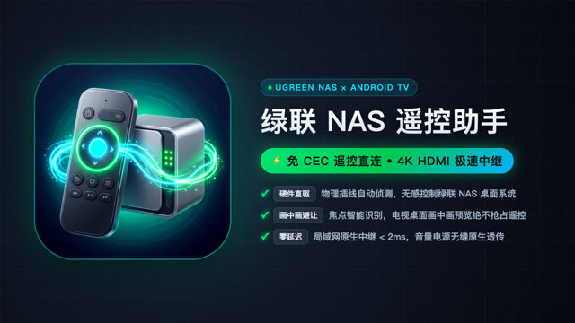

# 绿联 NAS 遥控助手 (NasTvRemote)

<p align="center">
  
</p>

<p align="center">
  <strong>⚡ 免 CEC 遥控直连 • 4K HDMI 极速中继 • 智能画中画避让</strong>
</p>

---

## 📖 项目简介

绿联私有云 NAS（UGOS Pro 系统，如 DX4600 / DXP 系列）配备了 HDMI 接口，支持直连电视或显示器输出 4K 原生桌面。然而，由于当前硬件与系统内核未开放 HDMI-CEC 协议，导致电视自带的遥控器无法直接控制 NAS 桌面。

**绿联 NAS 遥控助手 (NasTvRemote)** 是一款专为 Android TV（特别深度适配小米电视 / MIUI TV PatchWall）打造的轻量级原生遥控中继应用。

通过 Android 无障碍服务（AccessibilityService）与系统窗口焦点侦测，自动判断当前是否处于全屏 HDMI 信号源播放状态，并将遥控器的**方向键（上/下/左/右）、确认键（OK/Center）、返回键（Back）**以极速（< 2ms）透传至绿联 NAS 官方桌面控制接口（`:9999/ugreen/v1/hdmi/desktop/command`），实现免 CEC 遥控器无感操控！

---

## ✨ 核心特性

- 🎮 **免 CEC 硬件直连**：无需电视与 NAS 支持 HDMI-CEC 协议，电视遥控器直接当做 NAS 原生遥控器。
- 🖼️ **智能画中画（PiP）避让**：
  - 处于电视主桌面（`com.mitv.tvhome`）且背景有 HDMI 小窗预览时，**完全放行遥控器按键**，绝不干扰电视桌面正常操作与滚动。
  - 仅在进入全屏 HDMI 播放器（`ExternalSourceActivity`）时精准激活按键拦截。
- ⚡ **零感知极速中继**：后台异步缓存焦点判定与非阻塞 HTTP 客户端，按键响应延迟 < 2ms。
- 🔌 **物理端口自动探测**：读取系统 Tuner 流状态，实时展示 HDMI 物理插线状态与活跃输入源。
- 🔄 **开机自启与无感守护**：开机自动启动监听服务，重启电视后无需手动打开 App。
- 🎨 **电视专属高对比纯矢量图标**：全尺寸 512×512 纯矢量高对比绿联极光翠绿设计，4K 电视大屏超清锐利，无模糊插值。

---

## 🛠️ 系统架构与按键映射

```
[电视遥控器按键输入] 
         │
         ▼
[KeyRelayAccessibilityService]
         │
  [当前顶层焦点窗口 mCurrentFocus]
         │
         ├──► 电视桌面 (com.mitv.tvhome) ──► 【放行透传】(画中画不干扰)
         │
         └──► 全屏 HDMI 播放器 (ExternalSourceActivity)
                     │
                     ▼ 【拦截并中继】
       POST http://<NAS_IP>:9999/ugreen/v1/hdmi/desktop/command
       {"action": "click", "key": "up"|"down"|"left"|"right"|"confirm"|"back"}
```

| 遥控器按键 | Android Keycode | 映射中继指令 | 绿联 NAS 响应动作 |
| :--- | :---: | :---: | :--- |
| **向上键** | `KEYCODE_DPAD_UP` (19) | `up` | 焦点上移 |
| **向下键** | `KEYCODE_DPAD_DOWN` (20) | `down` | 焦点下移 |
| **向左键** | `KEYCODE_DPAD_LEFT` (21) | `left` | 焦点左移 |
| **向右键** | `KEYCODE_DPAD_RIGHT` (22) | `right` | 焦点右移 |
| **确认键** | `KEYCODE_DPAD_CENTER` (23) | `confirm` | 打开应用 / 确认点击 |
| **返回键** | `KEYCODE_BACK` (4) | `back` | 返回上一级 / 退出应用 |
| **主页/电源/音量** | `HOME` / `POWER` / `VOLUME` | *(系统原生处理)* | 电视系统原生响应，无缝切回电视桌面 |

---

## 🚀 安装与使用指南

### 1. 编译或下载安装包
如果本地编译，直接在项目根目录下执行：
```bash
./build_apk.sh
```
生成签名的 APK 位于 `build/NasTvRemote.apk`。

### 2. 通过 ADB 安装至电视
确保电视开启了“ADB 调试”：
```bash
adb connect <电视IP>:5555
adb install -r build/NasTvRemote.apk
```

### 3. 授予必要系统权限（推荐）
```bash
adb shell pm grant com.tao7.nasremote android.permission.WRITE_SECURE_SETTINGS
adb shell pm grant com.tao7.nasremote android.permission.DUMP
```

### 4. 开启服务
1. 打开电视上的【绿联NAS遥控助手】应用。
2. 输入您的绿联 NAS 局域网 IP（默认端口 9999），点击【测试连通性】。
3. 勾选绿联 NAS 所连接的 HDMI 端口（如 HDMI 1）。
4. 开启【开始按键中继监听】与【开机自动启动服务】开关。
5. 如提示无障碍权限未开启，点击按钮前往系统设置开启【绿联NAS遥控助手】辅助功能即可。

---

## 📦 项目结构

```
NasTvRemote/
├── app/
│   └── src/main/
│       ├── AndroidManifest.xml          # 清单文件 (LEANBACK + 无障碍配置)
│       ├── java/com/tao7/nasremote/
│       │   ├── MainActivity.java        # 配置界面与设备连通性测试
│       │   ├── KeyRelayAccessibilityService.java # 核心按键中继与画中画避让守护服务
│       │   ├── HdmiPortDetector.java    # HDMI 物理插线与活跃端口探测器
│       │   ├── NasApiClient.java        # 高速 HTTP 命令中继客户端
│       │   ├── BootReceiver.java        # 开机自启动广播接收器
│       │   └── AccessibilityHelper.java # 无障碍权限检查与跳转助手
│       └── res/
│           ├── layout/activity_main.xml # 遥控端大屏配置界面
│           ├── drawable/                # 纯矢量超清图标与高质感海报
│           └── mipmap-*/                # 各密度全尺寸启动图标
├── build_apk.sh                         # 一键自动化命令行构建脚本
└── README.md
```

---

## ⚠️ 免责声明与非官方说明 (Disclaimer)

1. **非官方独立工具**：本项目（NasTvRemote）为个人独立开发者制作的开源兼容性中继辅助工具，**与深圳市绿联科技股份有限公司（UGREEN）及小米科技有限责任公司（Xiaomi）不存在任何隶属、投资、合作、授权或背书关系**。
2. **商标权属归属**：文档及软件界面中出现的“绿联”、“UGREEN”、“小米”、“MIUI”、“Android”等字样及品牌标识，仅作为实现设备间互操作性的技术兼容性描述（指示性合理使用，Nominative Fair Use），其商标权与知识产权均归其各自合法权利人所有。
3. **接口合规性与合理使用**：本项目依据《计算机软件保护条例》第十七条关于“互操作性（Interoperability）与学习研究”之规定开发。项目源码均为自主原创编写，**绝不包含、分发任何绿联官方闭源二进制程序或专有加密组件**，亦未绕过任何系统鉴权措施，仅在用户局域网内与设备公开端点进行标准协议通讯。
4. **有限责任与风险自负**：软件按“现状”（AS-IS）提供，作者不对软件的功能完整性、持续兼容性作任何明示或暗示的担保。若绿联后续固件更新导致接口变动或功能失效，作者不承担维护承诺，亦不对因使用本软件造成的任何直接或间接后果承担连带责任。

---

## 📄 开源许可证 (License)

本项目基于 [Apache License 2.0](LICENSE) 协议开源。保留版权所有，遵循协议条款可自由修改与再分发。
